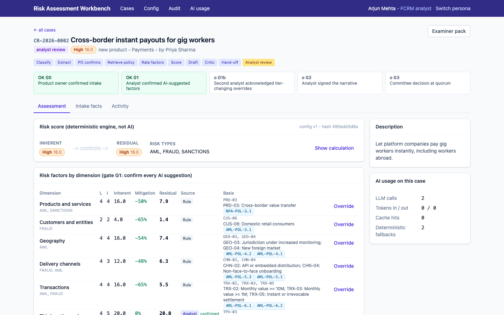

# Risk Assessment Workbench

**Genius Hacks 2026, problem statement: automate financial-crime risk assessment of new products and changes.**

A product owner submits a change. AI extracts the facts, finds the relevant policy, rates the six
financial-crime risk dimensions it can't cover with rules, and drafts a cited narrative. A fixed,
versioned scoring engine produces inherent and residual scores. An FCRM analyst reviews every number
and every sentence. A risk committee votes. **AI never recommends or records a decision** (ADR-006),
and every step lands in a hash-chained, append-only audit trail an examiner can verify.

Everything here is free: free-tier Gemini and Groq, open-source stack, synthetic data. With no API keys
the whole system (UI, tests, evals, demo) runs offline on deterministic fallbacks.

| | |
|---|---|
| Rubric evidence map | [below](#where-the-judging-criteria-live) |
| Presentation deck | [`docs/presentation.md`](docs/presentation.md) |
| Spec expanded from the brief | [`docs/requirements/spec.md`](docs/requirements/spec.md) (brief verbatim in [`00-brief.md`](docs/requirements/00-brief.md)) |
| Eval results and iteration history | [`evals/README.md`](evals/README.md), [`evals/results/`](evals/results/) |
| Token analysis | [`ops/token-analysis.md`](ops/token-analysis.md): 87% fewer tokens per case than a naive design |
| Failure log | [`ai/failure-log.md`](ai/failure-log.md) |



---

## Quick start (about 5 minutes)

Prerequisites: Python 3.12+, Node 20+, git. Docker is optional (only needed for the Postgres stack and k6).

```bash
make setup                 # venv + backend deps + frontend deps
cp .env.example .env       # optional: add free keys (below). Without keys = offline mode
make seed                  # demo users + 6 golden cases left at different workflow stages
make api                   # FastAPI on :8000   (terminal 1)
make web                   # React on :5173     (terminal 2)
```

Open http://localhost:5173 and click a persona. Every demo password is `demo`.

### Free LLM keys (optional, no credit card)
| provider | where | used for |
|---|---|---|
| Google Gemini | https://aistudio.google.com/apikey → `GEMINI_API_KEY` | narrative drafting and critique (`gemini-3.8-flash`), embeddings |
| Groq | https://console.groq.com/keys → `GROQ_API_KEY` | extraction, classification, factor suggestions (`qwen/qwen3.8-27b`) |

Each provider falls back to the other, then to the deterministic offline provider. Every fallback
shows on the case as a warning, so a reviewer always knows when AI help was degraded.
After adding keys, `make evals-live` runs the golden set on the real models and records the
responses so CI can replay them for $0.

### Full production-shaped stack (Docker)
```bash
make up      # Postgres+pgvector, API, web (:8080), Phoenix (:6006), Prometheus (:9090), Grafana (:3000, admin/admin)
make down
```

### Commands
| command | what |
|---|---|
| `make test` | 58 unit, property-based and API tests (offline, about 3 s) |
| `make e2e` | Playwright: full lifecycle through the UI with 5 personas, plus injection and RBAC checks |
| `make evals` | golden set (25) + held-out set (40) on replayed LLM responses, with gates |
| `make tokens` | regenerate `ops/token-analysis.md` from the LLM ledger |
| `make load` | k6 smoke (uses Docker if k6 isn't installed) |
| `make lint` | ruff + TypeScript typecheck |
| `make reseed` | wipe and reseed the SQLite demo database. Docker stack: `docker compose -f ops/deploy/docker-compose.yml down -v && make up` (the audit triggers rightly refuse deletes, so reset means a fresh volume) |
| `npm --prefix src/frontend run screenshots` | demo rehearsal against a seeded stack: walks every persona, fails if a step's UI state is missing, writes `docs/assets/*.png` |
| `npx @marp-team/marp-cli docs/presentation.md --pdf --allow-local-files` | rebuild the deck PDF |

---

## Demo walkthrough (by persona)

The seed leaves cases at every stage, so each step can be shown without waiting.

| ref | product | where it is | what it shows |
|---|---|---|---|
| G13 | IT hosting vendor in (fictional, sanctioned) Zelrania | Draft, waiting at G0 | PO fact confirmation |
| G01 | Cross-border instant payouts for gig workers | Analyst review, override pending second-analyst ack | the main case |
| G17 | Cash-funded remittances via agents, with a prompt injection in the brief | Analyst review | injection flagged, ignored by the pipeline |
| G18 | New savings feature (insufficient information) | Analyst review | AI-suggested factors marked pending, not silently scored |
| G02 | Retail crypto trading and custody in the mobile app | Committee voting, 2 of 3 votes cast | quorum |
| G03 | Branch-only senior savings | Approved | examiner pack, audit chain |

**1. Product owner: Priya** (`priya`)
- *New change request*: fill in the form, upload a PDF, DOCX, TXT or MD brief.
  Within seconds the AI has extracted customer types, geographies, channels, volumes, third parties and proposed controls.
- Every extracted value shows the **source span** it came from. Values whose quote can't be found in the document are flagged.
- **Gate G0**: Priya corrects anything wrong (with a reason) and confirms. Nothing reaches an analyst on unconfirmed facts.
- Open G13 to see a case waiting at G0.

**2. FCRM analyst: Arjun** (`arjun`), then **Sara** (`sara`)
- Open G01. The factor table shows likelihood × impact per dimension, each marked **Rule**, **AI**, or **Override**,
  with the mapped controls and their effectiveness, then inherent → residual.
- Click any narrative citation chip to read the policy text it cites. Sentences the critic couldn't verify carry a warning.
- **Gate G1**: AI-suggested factors must be accepted or overridden one by one. Arjun has already overridden
  Third-party/TPV to 4×5 with a reason. That changed the tier Medium → High, so **G1b** applies:
  log in as Sara to acknowledge it. The person who made the override can't acknowledge it.
- **Gate G2**: sign the narrative. Unresolved critic warnings need a written reason.
- Other analyst actions: request info from the PO (back to G0), re-run retrieval, redraft, export the examiner pack.
- G17 shows the injection flag. G18 shows pending factors on a thin submission.

**3. Risk committee: Meera, Dev, Lina, Kofi**
- Open G02. The committee sees the scores, the trace, the narrative and the overrides, **and no AI outcome or recommendation**.
- Vote approve / approve with conditions / reject, with reasons. Quorum is 3. A tie gives DEFERRED.
  A member who declares a conflict is excluded from the count.

**4. Anyone: governance views**
- *Audit*: every event, with "Verify chain integrity". Tampering with any row breaks the chain, and the database rejects UPDATE and DELETE.
- *Config* (analyst): scoring weights, tier boundaries and quorum, versioned and immutable.
  Each assessment records the config hash it was scored with.
- *Tokens*: per-case and per-node LLM usage from the ledger.
- G03 → *Examiner pack*: the full, self-contained evidence for one decision.

Traces of every graph node and LLM call are in Phoenix (:6006) when the Docker stack is up.

---

## How it works

```mermaid
flowchart LR
  PO[Product owner] -->|submit| X[classify + extract<br/>small LLM, span-checked]
  X --> G0{{G0 PO confirms facts}}
  G0 --> R[retrieve policy<br/>BM25 + vectors, no LLM]
  R --> F[factors<br/>rules first, AI only for gaps]
  F --> S[score<br/>deterministic, versioned config]
  S --> D[draft narrative<br/>large LLM, must cite]
  D --> C[critique<br/>deterministic, then LLM on doubtful claims]
  C -->|unsupported, max 1 retry| D
  C --> G1{{G1 / G1b / G2 analyst}}
  G1 --> G3{{G3 committee vote}}
  G3 --> A[(hash-chained audit)]
```



- **Orchestration**: LangGraph `StateGraph` with `interrupt()` at G0 and G1/G2, so the AI physically can't run past a gate.
  Checkpointed (SQLite or Postgres), so a restart resumes the case. Thread per run. Loops are bounded.
  The diagram is in [`docs/architecture/graph.mmd`](docs/architecture/graph.mmd), the code in `src/backend/raw/graph/`.
- **Context engineering**: a ~150-token *context pack* of the confirmed facts (`context_pack()` in
  `services/assessment.py`) is built once after G0 and replaces the raw documents in every later LLM node.
  The drafter also gets the engine's score table and two retrieved passages per dimension, each capped at 350 characters.
  Raw documents only ever go to the extractor, wrapped as untrusted data.
- **Where AI is and isn't used**: [`docs/architecture/overview.md`](docs/architecture/overview.md#where-ai-is-used-and-the-deterministic-alternative). Scoring, span checks,
  injection screening and decisions are never AI.
- **Model routing**: the small tier goes to Groq then Gemini; the large tier to Gemini then Groq. Response cache,
  12k-token budget per case, circuit breaker, deterministic fallback, ledger row for every call.

### Repository layout
```
src/backend/raw/   FastAPI app: api/, graph/ (LangGraph), llm/ (router, providers, guard), rag/, scoring/ (engine, rules),
                   services/ (assessment, gates, examiner), workflow/ (state machine), audit/ (hash chain), observability/
src/frontend/      React 19 + Vite + Tailwind; e2e/ Playwright specs
ai/                build-time agent roles (agents/), runtime prompts (prompts/, versioned YAML), SDLC prompts (sdlc/), failure log
docs/              requirements/, architecture/ (C4, ERD, ADR-001..007), governance/ (gates, AI governance), presentation.md
config/            scoring config v1 + rejected candidates, control library
data/              synthetic policy corpus, synthetic change requests
evals/             golden + held-out datasets, run_evals.py, results history, LLM recordings for replay
tests/             unit (incl. hypothesis), api, load (k6)
ops/               deploy/ (Dockerfiles, compose, nginx), monitoring/ (Prometheus, alerts, Grafana), runbook, go-live checklist, token analysis
```

---

## Decision log

The important ones are full ADRs in [`docs/architecture/adr/`](docs/architecture/adr/).

| # | decision | why | alternative rejected |
|---|---|---|---|
| ADR-001 | Scoring is a pure function over a versioned YAML config. The LLM never produces a score | Reproducible, tunable by FCRM without code, explainable to an examiner; analyst consistency is a pain point in the brief | LLM-assigned scores (non-deterministic, unexplainable) |
| ADR-002 | LangGraph with human interrupts inside the graph | Gates are structural, not a convention; checkpoint/resume; bounded loops are visible | Free-form multi-agent chat (CrewAI/AutoGen): harder to bound, audit and test |
| ADR-003 | Hybrid BM25 + vector retrieval on pgvector (or SQLite) | Policy text is full of exact terms (FATF, EDD, MSB) that BM25 nails; vectors catch paraphrase. One database | Separate vector DB (another service, no gain at this size) |
| ADR-004 | Free-tier Gemini + Groq with cross-fallback and an offline deterministic provider | Hackathon constraint is free-only; the demo must never fail for lack of quota | A single paid provider |
| ADR-005 | Hash-chained audit with DB-level append-only triggers | Tamper-evident and tamper-resistant; examiner can verify independently | Plain log table |
| ADR-006 | AI never recommends approve or reject; committee view hides any AI outcome | Brief says humans decide; avoids anchoring the committee; `outcome_leak` eval gate = 0 | "AI recommendation" field |
| ADR-007 | Alembic baseline + create_all, triggers in migration | One schema path for SQLite dev and Postgres prod | Hand-written SQL per database |
| D-8 | Rules first, AI only for dimensions the rules don't cover (91% of ratings came from rules in the eval run) | Consistency, cost, and an analyst can read a rule | AI rates everything |
| D-9 | Worst-dimension floor (0.8 × worst) kept even though it over-rates 9 of 25 golden cases | Two candidate configs that "fixed" it pushed under-rating to 32% and 16%. Under-rating is the costly error here | Tuning the config to match labels (`evals/README.md` runs 2-3) |
| D-10 | Second-analyst acknowledgement only for overrides that change the tier | Four-eyes where it matters, without slowing every edit | Four-eyes on everything |
| D-11 | Committee quorum 3, tie gives DEFERRED, conflicted members excluded | A tie isn't a decision; conflicts of interest must not count | Chair's casting vote |
| D-12 | Single uvicorn worker in the container | Bootstrap is idempotent but not concurrent-safe, and Prometheus multiprocess mode adds complexity; load test p95 is 65 ms on one worker | Multiple workers |
| D-13 | Synthetic, fictional policy corpus that cites public frameworks (FATF, Wolfsberg, JMLSG-style) | Brief: synthetic data only, no bank systems | Copying real bank policy |

---

## AI across all six SDLC stages

| stage | AI did | human did | evidence |
|---|---|---|---|
| 1 Requirements | Expanded the 1-page brief into a spec, 16 user stories, assumptions, regulatory research | Removed an invented 7th risk dimension and unverifiable paragraph references; set quorum and tie rules | `docs/requirements/`, `ai/sdlc/requirements/prompts.md` |
| 2 Design | Proposed architecture, ERD and ADR options with trade-offs | Chose deterministic scoring, LangGraph and gate placement | `docs/architecture/`, `ai/sdlc/design/prompts.md` |
| 3 Development | Implemented module by module under `AGENTS.md` invariants and `.cursor/rules/`, using role prompts (`ai/agents/`) | Reviewed diffs against the reviewer checklist; caught F-003 by reading output, not trusting green tests | commit history, `ai/failure-log.md` |
| 4 Testing | Generated tests from user stories, adversarial cases and the golden set; property-based scoring tests | Set eval thresholds, added the under-rating gate, caught a conditional assert (F-005) | `tests/`, `evals/` |
| 5 Deployment | Wrote Dockerfiles, compose and CI | Verified the Postgres path and append-only triggers; go-live checklist | `ops/deploy/`, `.github/workflows/ci.yml`, `ops/go-live-checklist.md` |
| 6 Operations | Dashboards, alerts with runbook, token report; **at runtime it drafts new eval cases from analyst overrides** | Triage, SME approval of eval candidates, config approval | `ops/`, `scripts/overrides_to_evals.py` |

---

## Where the judging criteria live

| criterion | weight | look at |
|---|---|---|
| AI harness and orchestration | 30% | `src/backend/raw/graph/` (graph, nodes, context pack), `src/backend/raw/llm/router.py`, `AGENTS.md`, `ai/agents/`, `tests/api/test_graph_orchestration.py` |
| SDLC automation | 20% | table above, `ai/sdlc/`, commit history, `.github/workflows/ci.yml` |
| Human-in-the-loop and governance | 15% | `docs/governance/review-gates.md`, `docs/governance/ai-governance.md`, `src/backend/raw/services/gates.py`, audit chain |
| Evals | 10% | `evals/README.md` (4 runs, 2 rejected candidates), `evals/run_evals.py`, CI gates |
| Context engineering | 10% | `context_pack()` in `src/backend/raw/services/assessment.py`, `src/backend/raw/rag/retriever.py`, `ai/prompts/*.yaml`, `AGENTS.md`, `.cursor/rules/` |
| Production readiness | 5% | `ops/` (compose, alerts, runbook, go-live), `tests/load/results.md` |
| Token efficiency | 5% | `ops/token-analysis.md` |
| Engineering judgement | 5% | decision log above, `ai/failure-log.md`, honest limitations in `evals/README.md` |

## Known limitations
- Golden tier labels are the designer's judgement, pending FCRM SME review. 25 cases is a small sample.
- Committed eval runs are offline mode until free keys are added and `make evals-live` records real responses.
  Offline numbers measure the rules, scoring, retrieval, safety screens and fallback extractor, not the LLMs.
- Demo authentication (seeded users, password `demo`). SSO and secrets management are on the go-live checklist.
- Free-tier provider terms may allow training on inputs: fine for synthetic data, not for real bank documents (see go-live checklist).
- Commits were made with `dulwich` (pure-Python git) because native git wasn't available on the build machine (F-002).
  The `.git` directory is standard; push with any git client.
