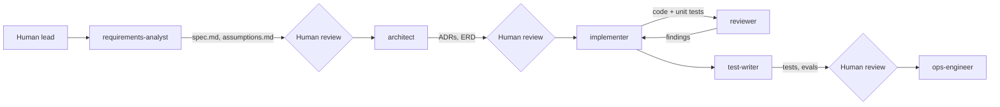

# Build-time subagents

The system was built by one human lead directing Cursor agents in distinct
roles. Each role has a fixed prompt (below files), a bounded scope and a
hand-off artefact. The human is the gate between roles.

| Role | Prompt | Allowed to write | Hand-off |
|---|---|---|---|
| requirements-analyst | `requirements-analyst.md` | `docs/requirements/` | spec, stories, assumptions |
| architect | `architect.md` | `docs/architecture/` | ADRs, diagrams, ERD |
| implementer | `implementer.md` | `src/`, `config/`, `ai/prompts/` | code + unit tests |
| reviewer | `reviewer.md` | nothing (comments only) | review findings list |
| test-writer | `test-writer.md` | `tests/`, `evals/datasets/proposed/` | tests, proposed eval cases |
| ops-engineer | `ops-engineer.md` | `ops/`, `.github/` | compose, CI, dashboards |

Why separate roles: narrow roles with explicit write scopes keep each agent's
context small (cheaper, less drift) and make every output reviewable by a human
in minutes. Real failures hit during the build are logged in `ai/failure-log.md`.
