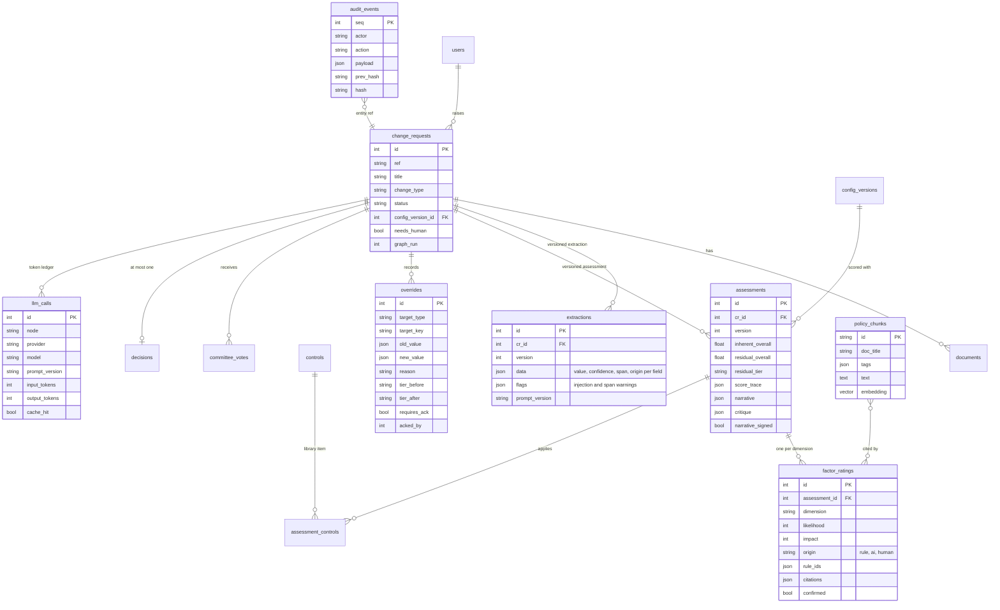

# Data model

The governed data layer the AI reasons over. Every AI output is stored next to
its provenance (model, prompt version, origin) and every human change is an
`override` row plus an audit event.

## Governance properties of the model
- **Versioned, never overwritten**: extractions, assessments and configs get new
  versions; old ones remain for the examiner.
- **Origin on every rating**: `rule` (with rule ids), `ai` (with model and
  citations) or `human` (with override id).
- **Config pinning**: each assessment references the config version it used.
- **Append-only audit**: DB triggers block UPDATE/DELETE; SHA-256 hash chain
  makes any out-of-band edit detectable.
- **Portable**: `embedding` is pgvector on Postgres and JSON on SQLite via one
  SQLAlchemy `TypeDecorator`.
