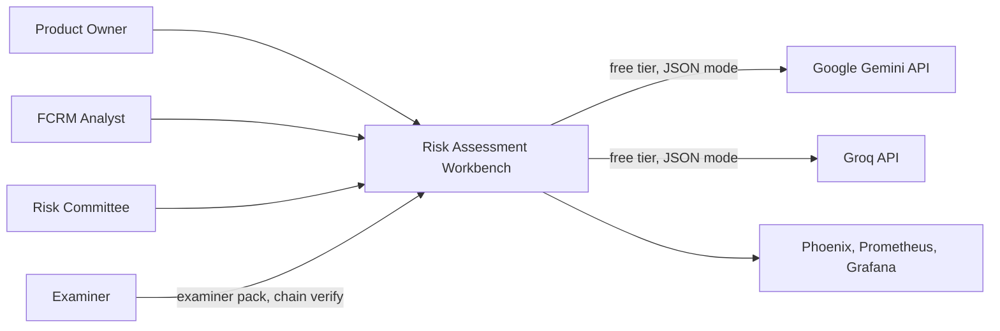
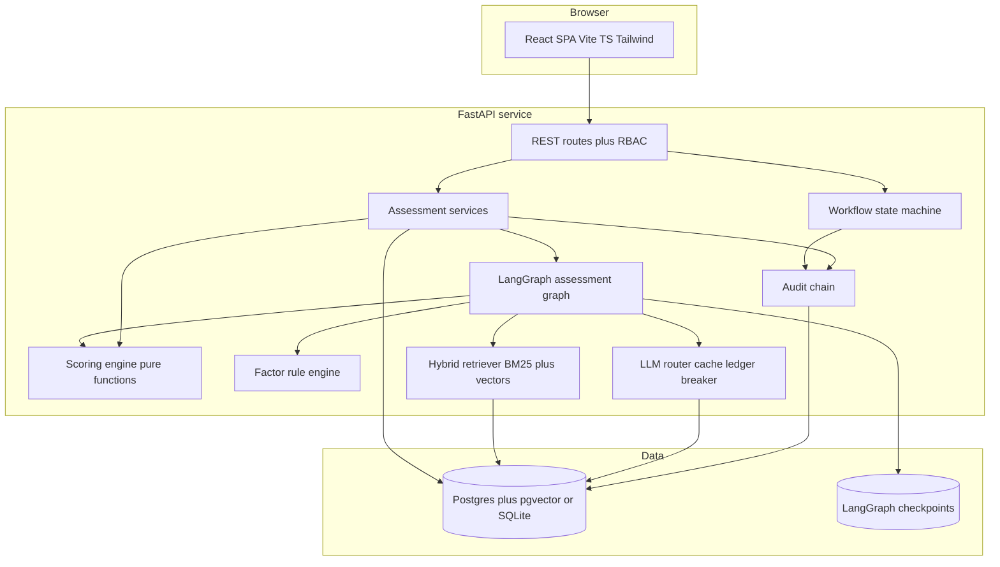
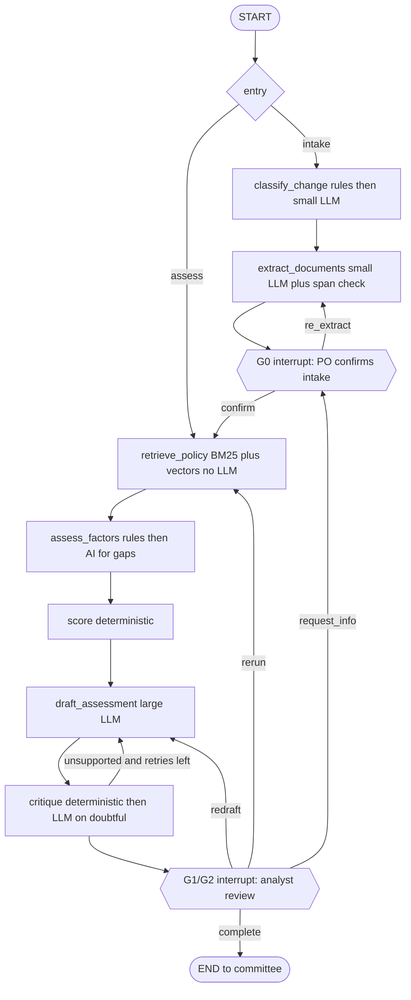

# Architecture overview

## Context (C4 level 1)

No connection to any real bank system (brief constraint). Both LLM providers
are optional: with no keys RAW runs fully offline with deterministic providers.

## Containers (C4 level 2)

## Runtime harness: the assessment graph

One LangGraph thread per case run (`thread_id = cr-<id>-run-<n>`), checkpointed
so a crash or restart resumes at the last completed node. Two human interrupts
live inside the graph, so the AI cannot run past a gate.

Design properties:
- **DB is the source of truth, graph state is orchestration.** Nodes read current
  facts from the DB (so analyst overrides made between interrupts are honoured)
  and keep only ids, warnings, counters and the context pack in graph state.
- **Context pack** (`raw/graph/context.py`): a compact (~1.5k tokens) structured
  summary of the case built once after G0 and reused by every LLM node.
- **Bounded loops**: critique -> draft at most once; LLM repair retry at most once.
- **Graceful degradation**: any LLM failure falls back to the deterministic
  offline provider and raises a visible warning; the case always reaches the analyst.
- **Token budget** per case enforced by the router before each call.

## Where AI is used, and the deterministic alternative

| Component | AI? | Model tier | Deterministic alternative | Why this choice |
|---|---|---|---|---|
| Change-type classification | Fallback only | small | Form field + keywords | Form field covers >90%; AI only when type is "other" |
| Document extraction | Yes | small | Regex/keyword extractor (offline provider) | Free text varies too much; regex baseline kept as fallback and eval baseline |
| Span verification | No | - | String match of quoted span in source | Checkable, so no LLM |
| Prompt-injection screen | No | - | Pattern rules | Deterministic, auditable |
| Policy retrieval | Embeddings only | embed | BM25 | Hybrid beats either alone (see evals) |
| Factor rating | Gaps only | small | Rule engine (`config/v1.yaml`) | Consistency between analysts is a stated pain point |
| Scoring | No | - | Pure function | Must be reproducible, tunable, examinable |
| Narrative drafting | Yes | large | Template narrative | Prose synthesis across policy is where AI earns its place |
| Critique | Partly | large | Citation + lexical-overlap check | Deterministic check first; LLM only on ambiguous sentences |
| Decision | Never | - | Committee vote | Brief: humans decide |

## Security
JWT bearer auth, role checked per route (`raw/api/deps.py`), uploads limited to
5 MB and 4 types, uploaded text is wrapped as untrusted data in prompts and
screened for injection patterns, secrets only via environment.
