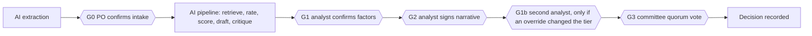

# Review gates

Each gate answers: **what risk does it control, why is it here, who owns it,
what evidence does it leave, and how is it enforced in code.**

| Gate | Owner | Risk controlled | Why here | Evidence | Enforcement |
|---|---|---|---|---|---|
| **G0 Intake confirmation** | Product owner | Extraction errors (wrong geography, missed crypto exposure) propagate into every later score | Earliest and cheapest point; the PO is the only person who *knows* the product | Confirmed extraction version, PO overrides with reasons, `intake.confirmed` audit event | `POST /submit` requires a confirmed extraction; graph is paused at `po_confirm` interrupt |
| **G1 Factor confirmation** | FCRM analyst | Mis-rating, especially AI-suggested ratings for factors no rule covers | After scoring so the analyst sees the consequence of each factor; before narrative sign-off so text matches numbers | `confirmed_by` on every AI-origin factor, overrides | `submit-to-committee` fails listing unconfirmed AI factors |
| **G1b Second analyst** | A different analyst | One person moving a tier (key-person risk, the brief's "depends on which analyst") | Only when an override changes the residual tier, so speed is preserved for routine cases | Override `acked_by` != `user_id` | Committee submission blocked while any `requires_ack` override is unacknowledged; self-ack rejected |
| **G2 Narrative sign-off** | FCRM analyst | Hallucinated or unsupported claims reaching the committee | After the critic has flagged unsupported sentences | `narrative_signed_by`, reason if warnings remain | Submission blocked if unsigned; unresolved critic warnings require a reason |
| **G3 Committee decision** | Risk committee (quorum) | Automated or single-person approval | The only point where an outcome exists | Votes with rationale, conflict declarations, conditions, decision record | `record_decision()` is the only path to a terminal state; quorum and conflict checks; invariant tests |

## Overrides (human disagreement with any system output)
- Any extraction field, factor rating, control effectiveness value or narrative
  section can be overridden. A reason of at least 15 characters is mandatory.
- Consequences are handled automatically: scores recompute, the narrative is
  marked stale if a factor changed, a tier change triggers G1b, the committee
  pack highlights every override, and an audit event is written.
- Each override is exported as a proposed eval case
  (`scripts/overrides_to_evals.py`), so disagreements improve the system.

## Separation of duties (RBAC)
| Action | PO | Analyst | Committee |
|---|---|---|---|
| Create case, upload, confirm intake | yes | - | - |
| Override extraction | pre-submit | yes | - |
| Override factors, controls, narrative | - | yes | - |
| Edit scoring/workflow config | - | yes | - |
| Vote, record decision | - | - | yes |
| View audit, export examiner pack | own cases | yes | yes |
