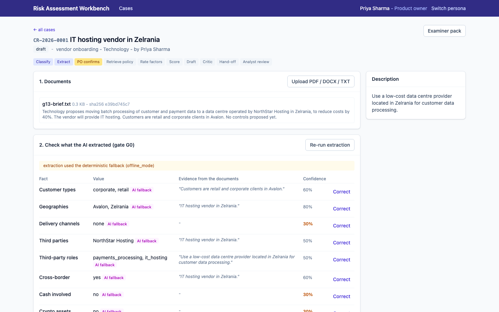
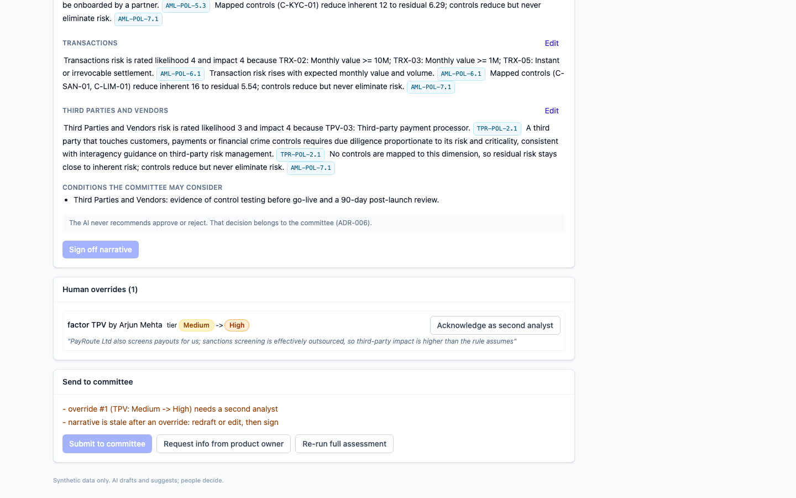

<!--
Render (free): npx @marp-team/marp-cli docs/presentation.md --pdf --allow-local-files
           or: VS Code / Cursor "Marp for VS Code" extension -> Export.
Screenshots: regenerate with `npm --prefix src/frontend run screenshots` against a seeded stack.
Every number on these slides comes from a file in the repo; the file is named on the slide.
-->

# Risk Assessment Workbench
### AI drafts and suggests. People decide. Every step is evidence.

Financial-crime risk assessment of new products and changes.

Genius Hacks 2026. Free-tier models and open-source tools only, $0 to run. Synthetic data only.

`README.md` is the map to everything on these slides.

---

<!-- Section 1: the problem and the spec -->
# 1. The problem as given

The brief (`docs/requirements/00-brief.md`, verbatim):
- New products and changes need a financial-crime risk assessment before launch.
- Today it's manual and slow, and the result **depends on which analyst** does it.
- Evidence for regulators is scattered.
- Humans must stay accountable for the decision.

What it deliberately didn't specify: which steps to automate, where people sit, how to score,
how to prove the AI didn't decide.

---

<!-- _class: dense -->
# 1. The specification we expanded it into

`docs/requirements/`: spec v1.0, 16 user stories, regulatory research, assumptions A-01..A-13, glossary

| decision the brief left open | our answer | where |
|---|---|---|
| Risk model | 6 dimensions × likelihood × impact, control effectiveness → residual | `spec.md` §4, `config/v1.yaml` |
| Who decides | Committee quorum of 3; AI never recommends | ADR-006 |
| What gets automated | Extraction, retrieval, gap-rating, drafting, critique | `spec.md` §6 |
| What never gets automated | Scoring, span checks, injection screen, the decision | `docs/architecture/overview.md` |
| Success measure | Time to decision-ready, with consistency between analysts | `spec.md` §1 |

Human edits to the AI-written spec: removed an invented 7th dimension ("reputational" is an impact,
not a source); removed paragraph references we couldn't verify (`regulatory-research.md`).

---

<!-- Section 2: harness -->
<!-- _class: dense -->
# 2. The harness: runtime orchestration

```
submit → classify → extract (small LLM, span-checked) → ⏸ G0 PO confirms
       → retrieve (BM25 + vectors, no LLM) → factors (rules first, AI for gaps)
       → score (pure function, versioned config) → draft (large LLM, must cite)
       → critique (deterministic, then LLM on doubtful claims) ↺ max 1 redraft
       → ⏸ G1 / G1b / G2 analyst → ⏸ G3 committee
```

- **LangGraph `StateGraph` with `interrupt()` at the gates.** The AI can't run past a human, by construction.
- **Checkpointed** (SQLite / Postgres): a restart resumes mid-case. One thread per run.
- **The DB is the truth; graph state is orchestration**, so analyst overrides between interrupts are honoured.
- **Bounded**: 1 redraft, 1 JSON-repair retry, 12k tokens per case, a circuit breaker per provider.
- Proven by `tests/api/test_graph_orchestration.py`: a scripted LLM drafts a sentence whose rating contradicts the engine; the test checks
  that exactly 2 drafts happen, the second prompt carries the critic's reason, and 0 claims stay unsupported.

---

# 2. The harness: model routing and degradation

| tier | first | then | then |
|---|---|---|---|
| small (extract, classify, suggest) | Groq Qwen3.8 27B | Gemini Flash | deterministic offline provider |
| large (draft, critique) | Gemini 3.8 Flash | Groq | deterministic offline provider |

- Every call: response cache → budget check → provider → JSON-schema validation → ledger row
  (prompt id@version, model, tokens, latency, fallback reason).
- **A fallback is never silent.** It's a warning on the case and a Prometheus counter, and it fires an alert
  (`LlmFallbackRateHigh`, runbook linked).
- So the demo can't fail for lack of a key or quota (ADR-004).

---

<!-- _class: dense -->
# 2. The harness: context management

**Runtime**
- The **context pack**: about 150 tokens of confirmed facts, built once after G0. Every later node gets it instead of the raw documents.
- Raw uploads go only to the extractor, wrapped as untrusted data, after an injection screen.
- Drafter input = context pack + the engine's score table + 2 passages per dimension (≤350 characters each).
- Prompts are versioned YAML (`ai/prompts/`) with output schemas. The version is stored on every output.

**Build time (the AI that built this)**
- `AGENTS.md`: product in one line, non-negotiable invariants, where things live, commands.
- `.cursor/rules/*.mdc`: path-scoped rules (backend, frontend, prompts-and-evals, core invariants).
- `ai/agents/`: role prompts (requirements analyst, architect, implementer, test writer, reviewer, ops engineer).
- Failures become rules: each `ai/failure-log.md` row names the guidance it changed.

---

<!-- Section 3: AI vs people -->
<!-- _class: dense -->
# 3. Where AI leads, where a person leads

| | AI leads | person leads |
|---|---|---|
| Intake | extracts facts with a source quote for each | **PO confirms or corrects, with reason (G0)** |
| Policy | finds relevant sections (hybrid retrieval) | - |
| Ratings | suggests only where no rule fires (9% of ratings) | **analyst accepts or overrides each one (G1)** |
| Scores | **never**: pure function, config hash recorded | FCRM owns the config (versioned, eval-gated) |
| Narrative | drafts with citations; critic checks claims | **analyst edits and signs; warnings need a reason (G2)** |
| Tier change | - | **a second analyst acknowledges (G1b)** |
| Decision | **never**; committee view shows no AI outcome | **committee votes, quorum of 3, ties defer (G3)** |

Enforced server-side in `services/gates.py`. Covered by `test_no_auto_decision_static_guard`,
an `outcome_leak = 0` eval gate, and E2E tests.

---



# G0 in the product

The product owner sees every extracted value next to the **quote it came from**. Low confidence is in red,
and fallback extraction is labelled.

They correct with a reason, then confirm. No analyst time is spent on unconfirmed facts.

Rationale for each gate (risk controlled, why here, evidence, enforcement): `docs/governance/review-gates.md`

---



# G1b and G2 in the product

Arjun's override moved the gig-payouts case from **Medium to High**, so a second analyst must acknowledge it.
Self-acknowledgement is rejected.

Submission to the committee lists exactly what's blocking it: the pending acknowledgement, and a narrative
that went stale after the override.

Audit: hash-chained; database triggers refuse UPDATE and DELETE.

---

<!-- Section 4: evals -->
# 4. Evaluation approach

The real pipeline (graph, services, scoring) runs end to end on each case, with a throwaway DB. `evals/run_evals.py`

| set | size | used for |
|---|---|---|
| `golden_v1` | 25 hand-written cases | facts, controls, residual tier (labelled **before** the engine ran), must-cite policy, injection, incomplete |
| held-out synthetic | 40 generated cases | extraction only; never used while tuning |
| from overrides | grows with use | every human correction becomes a candidate case for SME review |

**CI gates** (on recorded LLM responses, $0, deterministic): extraction F1 ≥ 0.85, flags ≥ 0.90,
must-cite recall ≥ 0.60, tier within one ≥ 0.95, **under-rating ≤ 10%**, groundedness ≥ 0.90,
injection detected = 1.0, **outcome leak = 0**, consistency = 1.0.

---

<!-- _class: dense -->
# 4. What the results showed

`evals/results/2026-10-01-2107-baseline-v1-after-F004.md`

| extraction F1 | flags | control F1 | must-cite recall | tier within one | tier exact | under-rated | groundedness | consistency |
|---|---|---|---|---|---|---|---|---|
| 0.986 | 0.992 | 0.99 | 0.79 | 1.0 | 0.56 | 2 / 25 | 1.0 | 1.0 |

**The interesting finding: the engine over-rates (9 of 25).** The worst-dimension floor (0.8 × worst) makes one
unmitigated 4×4 dimension High.

| candidate | tier exact | under-rate | verdict |
|---|---|---|---|
| v1 (floor 0.8) | 0.56 | 0.08 | **kept** |
| A: floor 0.7 | 0.60 | **0.32** | rejected by the gate |
| B: Medium boundary 8 | 0.56 | **0.16** | rejected by the gate |

Tuning to the labels would have hidden High-risk products. The question went to the SME as a labelling question.

---

# 4. Honest limits of these numbers

- The committed runs are **offline mode**: they measure rules, scoring, retrieval, safety screens and the
  fallback extractor, not the LLMs. `make evals-live` with free keys records the live baseline.
- 25 cases: one case is 4 points of tier agreement.
- Tier labels are designer judgement, pending FCRM SME review.
- Held-out set is template-generated, so its perfect score after F-004 is weak evidence.

All four are written down in `evals/README.md`. An eval that hides its limits isn't evidence.

---

<!-- Section 5: demo -->
# 5. Demonstration


Analyst view of the gig-payouts case: deterministic score, the factor table marked Rule / AI / Override, the gate strip.

---

<!-- _class: dense -->
# 5. Demo script (6 minutes)

Seeded stack: `make up` (or `make seed`, `make api`, `make web`). Rehearsed by `npm --prefix src/frontend run screenshots`.

| min | persona | do | point to |
|---|---|---|---|
| 0:00 | Priya (PO) | Open the Zelrania vendor case, then upload a new brief | spans and confidence, G0 |
| 1:00 | Arjun (analyst) | Gig payouts case: factor table (Rule / AI / Override) | "Show calculation": inherent → controls → residual, config hash |
| 2:00 | Arjun | Click a citation chip; point at the stale-narrative banner | policy text; critic verdicts |
| 2:45 | Arjun | Remittances case | prompt injection flagged and ignored |
| 3:15 | Sara (analyst 2) | Gig payouts: acknowledge Arjun's tier-changing override | G1b, four-eyes |
| 4:00 | Meera (chair) | Crypto custody case: 2 of 3 votes, cast the third | no AI outcome on screen; quorum |
| 5:00 | Meera | Audit → Verify chain; AI usage page; Examiner pack | tamper evidence, ledger |
| 5:30 | | Phoenix traces and the Grafana dashboard | one span per node and LLM call |

Fallback if the network fails: offline mode needs no network. The Playwright E2E run is the recorded walkthrough.

---

<!-- Section 6: failure handling + iteration -->
<!-- _class: dense -->
# 6. Failure handling in the product

| failure | what happens | where |
|---|---|---|
| Provider down or rate-limited | cross-provider fallback, then deterministic; warning + alert | `llm/router.py`, `ops/runbook.md` |
| Model returns bad JSON | schema validation, 1 repair retry, then fallback | `llm/router.py` |
| Extracted value not in source | flagged at G0, confidence lowered | span check |
| Prompt injection in an upload | screened, flagged on the case, ignored as data | `llm/guard.py`, G17 |
| Narrative claim unsupported | critic flags it → 1 redraft → analyst must resolve or give a reason | critique node, G2 |
| Thin submission | factors left *pending*, not confidently scored | G18, `incomplete_routed_to_human` |
| Crash mid-pipeline | resume from checkpoint | LangGraph checkpointer |
| Someone edits the audit table | DB refuses; chain verification fails | ADR-005 |

---

<!-- _class: dense -->
# 6. How the setup improved through iteration

`ai/failure-log.md`: each failure, how it was detected, the fix, **and the guidance changed so it doesn't recur**

| # | stage | what went wrong | caught by | guidance changed |
|---|---|---|---|---|
| F-002 | setup | no git on the build Mac | first `git status` | commits through dulwich; README prerequisite |
| F-003 | dev | all tests green, but G01 rated High (label Medium): bad keyword + a cut-off sentence | a human reading the output, not trusting green | inspection helper + extraction F1 and tier made CI gates |
| F-004 | evals | held-out F1 0.962 vs golden 0.982: "high-net-worth individuals" read as retail | held-out set | held-out set never used for tuning |
| F-005 | testing | AI-written test asserted US-08 only `if requires_ack`, so it could pass vacuously | line-by-line review against stories | reviewer rule: no conditional asserts |
| F-007 | docs | AI-written docs cited a file that never existed and a 10× wrong token figure | grepping every doc claim against the code; the demo rehearsal script | reviewer rule: every path and number in docs is checked |

Pattern: the AI produced plausible results that were wrong three times (F-003, F-005, F-007). Each was caught
by a person checking it against the intent, then turned into an automatic check or a written rule.

---

<!-- Section 7: tokens -->
<!-- _class: dense -->
# 7. Token consumption and efficiency

`ops/token-analysis.md` (generated from the LLM ledger by `make tokens`)

| | tokens / case | LLM requests / case |
|---|---|---|
| Naive design (every task gets all documents + the whole policy corpus) | 39,566 | 10 |
| **This system (upper bound: prompt estimate + max output)** | **5,026** | **2.6** |
| Reduction | **87%** | **74%** |

| lever | evidence |
|---|---|
| Rules first; LLM only for uncovered dimensions | 136/150 ratings from rules (91%), about 4.0k tokens / case saved |
| Top-k hybrid retrieval instead of the corpus | about 2.1k saved |
| Deterministic critic first; LLM critic only on doubtful claims | about 0.9k saved |
| Context pack instead of raw docs | grows with document size (a real 10-page brief is about 5k tokens) |
| Small model for small tasks; cache; 12k budget per case | routing in prompt YAML |

Why it matters at $0: free tiers are rate-limited, so fewer requests per case means more cases per day inside the quota.

---

<!-- _class: dense -->
# AI across all six delivery stages

| stage | AI | person | evidence |
|---|---|---|---|
| Requirements | spec, stories, research | cut an invented dimension and unverifiable references | `docs/requirements/`, `ai/sdlc/requirements/` |
| Design | architecture and ADR options | chose deterministic scoring, gate placement | `docs/architecture/`, `ai/sdlc/design/` |
| Development | module-by-module under `AGENTS.md` | diff review; caught F-003 | commit history |
| Testing | tests from stories, adversarial and golden cases | thresholds, under-rating gate, F-005 | `tests/`, `evals/` |
| Deployment | Dockerfiles, compose, CI | verified Postgres path and triggers; go-live checklist | `ops/deploy/`, `.github/workflows/` |
| Operations | alerts, runbook, token report; **turns overrides into eval cases at runtime** | triage, SME approval | `ops/`, `scripts/overrides_to_evals.py` |

---

<!-- _class: dense -->
# Production readiness, and what's left

Done: docker-compose (Postgres + pgvector, API, web, Phoenix, Prometheus, Grafana) verified;
6 alerts, each linked to a runbook section; k6 at 20 concurrent users: 0% errors, read p95 65 ms;
CI runs lint, tests, replay evals, Postgres migration, E2E and load.

Before a real bank used it (`ops/go-live-checklist.md`):
- SSO and a secrets manager in place of demo logins.
- **Data classification for external LLMs.** Free-tier terms may allow training on inputs: fine for
  synthetic data, not for real documents. Swap in enterprise terms or a self-hosted model behind the same router.
- Model risk management review; SME sign-off on golden labels; a 4-6 week parallel run.

---

<!-- _class: dense -->
# Questions we expect

- **"Why not let the LLM score?"** Consistency between analysts is the brief's pain point. A pure function with
  a versioned config is reproducible and examinable. AI rates only gaps, and every AI rating needs a person (G1).
- **"Isn't 0.56 tier-exact low?"** Within-one is 1.0 and under-rating is 8%. We chose to over-rate. Both alternative
  configs (one of them better on exact match) were rejected because they under-rated High-risk products.
- **"Why LangGraph rather than a multi-agent crew?"** Interrupts make the gates structural, checkpoints give
  resume, and bounded loops are testable (ADR-002).
- **"What if the model goes down mid-demo?"** It falls back and says so. Offline mode is the floor.
- **"How would this get better in use?"** Every override becomes a candidate eval case (`scripts/overrides_to_evals.py`),
  plus the alert when the override rate on AI suggestions passes 40%.
